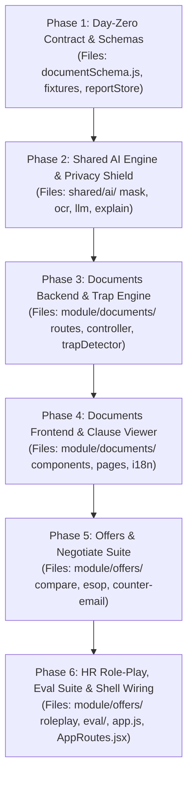

# Akumas / Fin-Buddy — P1 Comprehensive Roadmap & Execution Agenda

> **Owner:** P1 (AI Engine, Documents Pipeline, Offer Comparison & Negotiation)  
> **Backup Partners:** P2 (Documents), P3 (Offers)  
> **Core Architecture Principle:** *"LLM explains and extracts, code calculates. Never trust the LLM with math or tax figures."*  
> **Compliance & Safety:** Educational financial clarity (SEBI-safe, not financial/legal advice). Strict local PII redaction before external API calls.

---

## 🔒 Strict File & Folder Boundary Policy (MANDATORY)

To prevent merge conflicts, preserve architectural separation, and prevent regression between team members (P1, P2, P3), **P1 must strictly adhere to the following file boundaries**:

### 1. Allowed Folders & Files (Full Ownership by P1)
P1 is authorized to create, edit, and maintain files **ONLY** within these paths:

```text
fin-buddy/
├── agend.md                                      # P1 Roadmap & Agenda (Root & src)
├── backend/src/
│   ├── module/documents/                         # P1 Page 3 Backend
│   │   ├── index.js                              # Public interface (exports only)
│   │   ├── documents.routes.js                   # API routes
│   │   ├── documents.controller.js               # Route handlers & validation
│   │   ├── documents.service.js                  # Pipeline coordination
│   │   └── trapDetector.js                       # Predatory clause & risk classifier
│   │
│   ├── module/offers/                            # P1 Page 4 Backend
│   │   ├── index.js                              # Public interface (exports only)
│   │   ├── offers.routes.js                      # API routes
│   │   ├── offers.controller.js                  # Comparison, ESOP & negotiation handlers
│   │   ├── offers.service.js                     # Business logic
│   │   └── roleplayEngine.js                     # AI HR recruiter persona engine
│   │
│   └── shared/
│       ├── ai/                                   # P1 Shared AI Services
│       │   ├── ocr.js                            # PDF text-layer + local OCR fallback
│       │   ├── mask.js                           # Presidio/Regex local PII redaction
│       │   ├── llm.js                            # LLM client adapter with cache
│       │   └── explain.js                        # Jargon explainer (Fresher / Veteran)
│       ├── validator/
│       │   └── documentSchema.js                 # P1-owned JSON schema for documents
│       ├── reportStore/                          # Shared report store interface
│       │   └── index.js                          # In-memory document session storage
│       └── data/fixtures/                        # Day-zero mock files
│           ├── sampleOfferLetter.json
│           └── samplePayslip.json
│
├── frontend/src/
│   ├── module/documents/                         # P1 Page 3 Frontend
│   │   ├── index.js                              # Module entry point
│   │   ├── i18n.js                               # Localized strings (EN + HI, Fresher/Veteran)
│   │   ├── services/documentsApi.js              # Frontend API client
│   │   ├── pages/DocumentsPage.jsx               # Main 4-tab container
│   │   └── components/                           # UploadBox, MaskPreview, ReviewForm, ClauseViewer
│   │
│   └── module/offers/                            # P1 Page 4 Frontend
│       ├── index.js                              # Module entry point
│       ├── i18n.js                               # Localized strings (EN + HI)
│       ├── services/offersApi.js                 # Frontend API client
│       ├── pages/OffersPage.jsx                  # Main 4-tab container
│       └── components/                           # CompareTable, EsopCalc, CounterEmail, RolePlayChat
│
└── eval/                                         # P1 Academic Evaluation & Benchmark
    ├── dataset/                                  # 30-50 synthetic & anonymized test docs
    ├── run_extraction_eval.js                    # Precision/recall test against ground truth
    └── run_baseline_comparison.js                # Hybrid pipeline vs LLM-only math error
```

---

### 2. Allowed Shared Integration Points (Minimal Edits Only)
P1 may touch **ONLY** the registration lines in these two shared application shell files owned by P3:
- **`backend/src/app.js`**:
  - *Allowed Action:* Import and mount `documentsRouter` and `offersRouter` from their respective module `index.js`.
  - *Rule:* Do not modify middleware, server configurations, or routes owned by P2 or P3.
- **`frontend/src/AppRoutes.jsx`**:
  - *Allowed Action:* Register the routes `/documents` (pointing to `DocumentsPage`) and `/offers` (pointing to `OffersPage`).
  - *Rule:* Do not modify routes for `/home`, `/assistant`, `/salarytax`, or `/moneyplan`.

---

### 3. ⛔ STRICTLY OFF-LIMITS (Do NOT Touch or Create Files Here)
Under no circumstances should P1 modify or create files in the following domains:

| Off-Limits Domain | Owner | Reason & Boundary Rule |
|---|---|---|
| `backend/src/module/salarytax/**`<br>`frontend/src/module/salarytax/**` | **P2** | In-hand waterfall, payslip audit, tax calculators. Call only via `salarytax/index.js`. |
| `backend/src/module/moneyplan/**`<br>`frontend/src/module/moneyplan/**` | **P2** | Financial health score, goal planner, debt/loan tools, admin area. |
| `backend/src/shared/data/taxRules.json`<br>`backend/src/shared/calcResult.js` | **P2** | Hotspot files owned exclusively by P2. P1 never modifies tax slabs or formulas. |
| `backend/src/module/home/**`<br>`frontend/src/module/home/**` | **P3** | Landing page, user auth/profile, career timeline, Market Movers. |
| `backend/src/module/assistant/**`<br>`frontend/src/module/assistant/**` | **P3** | Ask-anything tax assistant, CA review pack, voice integrations. |

> ⚠️ **Cross-Module Rule:** Never use relative paths to import internal files of another module (e.g. `import ... from '../salarytax/services/math.js'`). Modules communicate **ONLY** through the target module's `index.js` or via the shared `reportStore`.

---

## 6 Minor Execution Phases for P1



---

### Phase 1: Day-Zero Foundation, Schemas & Mock Data (Unblock Team)

#### 1. Objective
Establish the formal data contracts, JSON schemas, and realistic mock fixtures on Day 1. This guarantees that P2 (Salary & Tax) and P3 (Home/Dashboard) can immediately build against stable sample data without waiting for the OCR or LLM pipeline to be implemented.

#### 2. Exact Files to Create / Modify
- `backend/src/shared/validator/documentSchema.js`
- `backend/src/shared/data/fixtures/sampleOfferLetter.json`
- `backend/src/shared/data/fixtures/samplePayslip.json`
- `backend/src/shared/data/fixtures/sampleTrapFlags.json`
- `backend/src/shared/reportStore/index.js`

#### 3. Scope of Work
- **`documentSchema.js`**:
  - Comprehensive JSON schema defining valid structures for Indian Offer Letters, Payslips, Form 16, and Loan Letters.
  - Standardized compensation fields:
    - Base Salary, HRA, Special Allowance, PF (Employer/Employee), Gratuity, Professional Tax.
    - Performance Bonus, Joining Bonus, Retention Bonus, Clawback Period (months).
    - ESOP/Stock Grants (number of options, strike price, vesting schedule, cliff).
    - Contractual Terms: Notice period (days), Probation period, Bond duration (months), Bond penalty amount, Non-compete radius & duration, Moonlighting/IP terms.
- **Day-Zero Mock Fixtures**:
  - `sampleOfferLetter.json`: Realistic Indian tech offer (₹18.5 LPA CTC breakdown with variable, ESOPs, 90-day notice period, ₹2L training bond).
  - `samplePayslip.json`: Matching monthly salary slip showing gross pay, EPF deduction, professional tax, TDS, and net take-home.
  - `sampleTrapFlags.json`: Pre-parsed clause flags with severity and page coordinates.
- **Report Store Interface (`reportStore/index.js`)**:
  - In-memory session store exposing `saveReport(docId, data)`, `getReport(docId)`, and `listReports(userId)`.
  - Enforces isolation: all modules read extraction results through this interface rather than direct internal file imports.

#### 4. Done When
- `documentSchema.js` validates valid offer letter and payslip JSON payloads and throws clear validation errors on malformed payloads.
- Sample mock JSON files are accessible to P2 and P3 via `reportStore.getReport()`.
- Automated test verifies schema compliance for Day-Zero contracts.

---

### Phase 2: Shared AI Engine & Privacy Shield (OCR, Local Masking & LLM Adapter)

#### 1. Objective
Build the secure backend AI services in `backend/src/shared/ai`. Ensure that sensitive user data (PAN, Aadhaar, account numbers, names) is permanently redacted locally *before* any text reaches third-party LLMs, and establish a robust, fail-safe LLM interface.

#### 2. Exact Files to Create / Modify
- `backend/src/shared/ai/mask.js`
- `backend/src/shared/ai/ocr.js`
- `backend/src/shared/ai/llm.js`
- `backend/src/shared/ai/explain.js`
- `backend/src/shared/ai/index.js` (public exports for shared AI)

#### 3. Scope of Work
- **Local PII Masker (`mask.js`)**:
  - High-precision regex and deterministic tokenizers for Indian identifiers:
    - PAN (`[A-Z]{5}[0-9]{4}[A-Z]`) $\rightarrow$ `[MASKED_PAN_1]`
    - Aadhaar (`\b\d{4}\s?\d{4}\s?\d{4}\b`) $\rightarrow$ `[MASKED_AADHAAR]`
    - Indian Mobile Numbers (`(?:(?:\+|0{0,2})91[\s-]*)?[6-9]\d{9}`) $\rightarrow$ `[MASKED_PHONE]`
    - Bank Account numbers & IFSC codes $\rightarrow$ `[MASKED_BANK_ACCOUNT]`
    - Candidate Name & Address patterns $\rightarrow$ `[MASKED_CANDIDATE_NAME]`
  - Masking reversible mapping dictionary stored only in volatile memory for the active session, never logged or saved to disk.
- **Layered OCR Pipeline (`ocr.js`)**:
  - **Tier 1 (Digital PDF Layer):** Uses `pdfjs-dist` / `pdf-parse` to extract clean text and bounding box coordinates instantly for digital PDFs.
  - **Tier 2 (Scanned/Image Fallback):** OpenCV/Tesseract preprocessing (deskewing, binarization, noise filtering) feeding local OCR with bounding box preservation.
- **LLM Adapter Layer (`llm.js`)**:
  - Standardized client interface with support for Google Gemini API (free tier) and Groq/OpenRouter.
  - Strict JSON mode (`response_format: { type: "json_object" }`).
  - Cached offline fallback: returns structured cached response on network timeouts or quota exhaustion.
- **Plain-Language Explainer (`explain.js`)**:
  - Translates complex legal/financial jargon into plain language.
  - Supports **Fresher Depth** ("Explain like I'm 5", e.g., what is Gratuity or PF) vs. **Veteran Depth** ("Explain like a pro", e.g., Section 17(2) perquisite tax, clawback risks).
  - Localization integration with English and Hindi prompts.

#### 4. Done When
- A document containing a real PAN, phone, and name has all PII redacted locally before any LLM API call is dispatched.
- Digital PDFs return text with word-level bounding boxes.
- LLM adapter successfully extracts structured JSON and recovers gracefully from simulated network failures using cache.

---

### Phase 3: Documents Module Backend & Clause Trap Engine

#### 1. Objective
Implement the complete backend processing flow for Page 3 (`/documents`), connecting document upload, OCR extraction, schema validation, and intelligent trap detection.

#### 2. Exact Files to Create / Modify
- `backend/src/module/documents/documents.routes.js`
- `backend/src/module/documents/documents.controller.js`
- `backend/src/module/documents/documents.service.js`
- `backend/src/module/documents/trapDetector.js`
- `backend/src/module/documents/index.js` (exports router and service)

#### 3. Scope of Work
- **Documents Router & Controller (`module/documents/`)**:
  - `POST /documents/upload`: Multer upload middleware (5MB limit, PDF/PNG/JPEG only); runs OCR + PII masking; stores session text in memory; returns masked preview data + session token.
  - `POST /documents/extract`: Takes user-confirmed masked text; calls LLM extraction; validates against `documentSchema.js`; computes extraction confidence score per field.
  - `GET /documents/:id`: Retrieves saved structured report from `reportStore`.
  - `PUT /documents/:id`: Updates fields edited by user during manual review.
  - `GET /documents/:id/flags`: Evaluates and returns all flagged clauses and risks.
- **Clause Trap Detector (`trapDetector.js`)**:
  - Classifies common predatory employment clauses:
    - **Notice Period Trap:** Flags notice periods $\ge 60$ or $90$ days as `HIGH_RISK` (reduces future offer mobility).
    - **Training Bond / Financial Penalty:** Identifies compulsory retention periods (e.g., 2 years) and clawback penalties.
    - **Variable Pay Ambiguity:** Flags compensation packages where variable component $> 20\%$ or conditions are undefined.
    - **Non-Compete & Moonlighting:** Identifies overly broad geographic restrictions and blanket bans on side projects.
    - **Joining Bonus Clawback:** Highlights conditions requiring full bonus repayment upon departure within 12 months.
  - **Source Linking:** Every detected flag contains `{ clauseId, type, severity, title, explanation, pageNumber, textSpan, boundingBox }`.
- **Security & Privacy Guard**:
  - Zero temporary file retention: uploaded files are processed in-memory or immediately unlinked (`fs.unlinkSync`) after OCR.
  - Logs are sanitized to ensure no salary figures or PII are printed to `stdout`.

#### 4. Done When
- Uploading a sample multi-page offer letter returns masked text and structured JSON matching `documentSchema.js`.
- Clause detector automatically flags a 90-day notice period and a ₹1.5L bond with exact page number and text quote.
- Temporary files are verified deleted from server storage post-processing.

---

### Phase 4: Documents Module Frontend & Interactive Clause Viewer

#### 1. Objective
Build the rich 4-tab user interface for Page 3 (`/documents`) in React (`frontend/src/module/documents/`), delivering an intuitive, privacy-first user experience.

#### 2. Exact Files to Create / Modify
- `frontend/src/module/documents/pages/DocumentsPage.jsx`
- `frontend/src/module/documents/components/UploadSection.jsx`
- `frontend/src/module/documents/components/MaskPreview.jsx`
- `frontend/src/module/documents/components/ReviewForm.jsx`
- `frontend/src/module/documents/components/ClauseViewer.jsx`
- `frontend/src/module/documents/components/PdfViewer.jsx`
- `frontend/src/module/documents/services/documentsApi.js`
- `frontend/src/module/documents/i18n.js`
- `frontend/src/module/documents/index.js` (exports page and api)

#### 3. Scope of Work
- **Tab 1: Upload Screen (`UploadSection.jsx`)**:
  - Drag-and-drop file upload zone supporting PDF and images.
  - Document type dropdown: *Offer Letter*, *Payslip*, *Form 16*, *Loan Agreement*.
  - Visual progress bar: OCR scanning $\rightarrow$ Redacting PII $\rightarrow$ Analyzing clauses.
- **Tab 2: Mask Preview & Privacy Shield (`MaskPreview.jsx`)**:
  - Interactive privacy view demonstrating that PAN, Aadhaar, and personal contact details are redacted.
  - User confirmation button: *"I confirm my private data is masked — Proceed to AI Analysis"*.
- **Tab 3: Review & Edit Form (`ReviewForm.jsx`)**:
  - Clean field-by-field breakdown of extracted numbers (Base, HRA, Allowances, Deductions, Bonus, Stock).
  - Visual **Confidence Badges** (Green: $\ge 90\%$, Yellow: $70\text{--}89\%$, Red: $< 70\%$).
  - Allows the user to manually correct any misread OCR values before committing to the `reportStore`.
- **Tab 4: Clauses & Traps Viewer (`ClauseViewer.jsx` & `PdfViewer.jsx`)**:
  - Document reader displaying the document pages with color-coded bounding boxes around risky clauses:
    - 🔴 Red: Critical traps (Bonds, hefty clawbacks).
    - 🟡 Yellow: Moderate risks (90-day notice period, high variable pay).
    - 🔵 Blue: Informational clauses (Probation terms, medical coverage).
  - Clicking any clause opens a sidebar/modal with:
    - Clause Title and Severity Badge.
    - Exact clause excerpt.
    - Plain-language explanation ("What this means for you").
    - Actionable recommendation ("What to ask HR").
- **Localization & Depth Toggles (`i18n.js`)**:
  - Complete English and Hindi strings wired into `i18n.js`.
  - Global `Fresher` vs. `Veteran` depth toggle dynamically switching explanation complexity.

#### 4. Done When
- User can drag-and-drop an offer letter PDF, review masked PII, edit extracted values, and see highlighted clause traps on the document viewer.
- Clicking a trap in the list smoothly scrolls to and highlights the corresponding clause bounding box.
- Switching between English and Hindi updates all UI labels and explanation text without page reload.

---

### Phase 5: Offers & Negotiate Suite (Comparison, ESOP Calculator & Counter-Email)

#### 1. Objective
Implement the core features of Page 4 (`/offers`), enabling users to compare competing job offers side-by-side, simulate equity/ESOP value under realistic scenarios, and generate custom negotiation counter-offers.

#### 2. Exact Files to Create / Modify
- `backend/src/module/offers/offers.routes.js`
- `backend/src/module/offers/offers.controller.js`
- `backend/src/module/offers/offers.service.js`
- `backend/src/module/offers/index.js`
- `frontend/src/module/offers/pages/OffersPage.jsx`
- `frontend/src/module/offers/components/CompareOffers.jsx`
- `frontend/src/module/offers/components/EsopCalculator.jsx`
- `frontend/src/module/offers/components/CounterEmail.jsx`
- `frontend/src/module/offers/services/offersApi.js`
- `frontend/src/module/offers/i18n.js`
- `frontend/src/module/offers/index.js`

#### 3. Scope of Work
- **Tab 1: Side-by-Side Offer Comparison (`CompareOffers.jsx`)**:
  - Supports comparing 2 to 4 job offers simultaneously.
  - Offer sources: Automatically loads extracted offers from `reportStore` or allows manual input.
  - Comparison Matrix Rows: Cost to Company (CTC), Monthly In-Hand (calculated deterministically via P2's `salarytax/index.js`), Guaranteed Fixed vs. Variable split (%), Joining Bonus, Notice Period, Bond liability.
  - Winner per row highlighted with green badge.
  - Every calculation cell includes a **"Why this number?"** tooltip conforming to `{ value, formula, inputs, assumptions, source }`.
- **Tab 2: ESOP & Equity Valuation Calculator (`EsopCalculator.jsx`)**:
  - Input parameters: Total grant options, Current strike price, Total company shares, Cliff period, Vesting schedule (4 years 25% annual).
  - Code-calculated scenario projections: Bear (1x–2x), Base (5x), and Bull (10x+).
  - Calculates estimated tax liability upon exercise (Perquisite tax under Section 17(2)) and exit capital gains.
- **Tab 3: AI Counter-Offer Email Generator (`CounterEmail.jsx`)**:
  - User chooses negotiation asks (higher fixed base, joining bonus, reduced notice period).
  - Code injects verified numbers into prompt (LLM never invents numbers).
  - Tone selector: *Polite & Enthusiastic*, *Confident & Assertive*, *High-Leverage Multi-Offer*.
  - One-click "Copy to Clipboard" and "Export Draft".
- **Backend Endpoints (`module/offers/`)**:
  - `POST /offers/compare`: Takes 2–4 offer objects, calls `salarytax` calculation logic, returns comparison matrix.
  - `POST /offers/esop`: Computes vesting schedule, scenario returns, and exercise costs.
  - `POST /offers/email`: Injects computed figures into negotiation prompt and returns formatted email copy.

#### 4. Done When
- Two sample offers are compared side-by-side with accurate monthly in-hand figures and "Why this number?" breakdowns.
- ESOP calculator displays year-by-year vesting projections across Bear, Base, and Bull scenarios.
- Counter-offer email generates customized text with real numbers correctly inserted.

---

### Phase 6: HR Role-Play Simulator, Academic Eval Benchmark & Shell Integration

#### 1. Objective
Deliver the demo showstopper — an interactive AI HR negotiation simulator with scoring — accompanied by the academic evaluation benchmark comparing LLM-only vs. Hybrid extraction accuracy, and complete clean mounting in the shared shell files (`app.js`, `AppRoutes.jsx`).

#### 2. Exact Files to Create / Modify
- `backend/src/module/offers/roleplayEngine.js`
- `frontend/src/module/offers/components/HrRoleplay.jsx`
- `frontend/src/module/offers/components/NegotiationScorecard.jsx`
- `eval/dataset/sample_offers.json`
- `eval/run_extraction_eval.js`
- `eval/run_baseline_comparison.js`
- `backend/src/app.js` *(Shared: ONLY register documents & offers routes)*
- `frontend/src/AppRoutes.jsx` *(Shared: ONLY register /documents & /offers route paths)*

#### 3. Scope of Work
- **Tab 4: Interactive HR Role-Play Chat (`HrRoleplay.jsx` & `roleplayEngine.js`)**:
  - Live conversational chat interface where the AI plays an HR recruiter.
  - Difficulty personas: *Friendly Recruiter*, *Stubborn Enterprise HR*, *Aggressive Startup Founder*.
  - Dynamic conversational responses grounded in the user's specific offer numbers.
  - **End-of-Session Scorecard (`NegotiationScorecard.jsx`)**: Evaluates Assertiveness, Professionalism, Leverage utilization, and provides a score out of 100 with suggested phrasing improvements.
  - Backend route: `POST /offers/roleplay`.
- **Academic Evaluation Harness (`eval/`)**:
  - Dataset of 30 synthetic and anonymized Indian offer letters/payslips (`eval/dataset/`).
  - `run_extraction_eval.js`: Measures field-level precision, recall, and character accuracy.
  - `run_baseline_comparison.js`: Compares our hybrid pipeline (`OCR -> Mask -> LLM -> Schema -> Code Calc`) against naive LLM-only calculation.
  - Generates clear benchmark table proving why naive LLM calculation fails ($>40\%$ error on Indian tax slabs) and our hybrid pipeline achieves $100\%$ mathematical accuracy.
- **Shared App Shell Integration (Controlled)**:
  - Register `/api/documents` and `/api/offers` inside `backend/src/app.js`.
  - Register `/documents` and `/offers` routes inside `frontend/src/AppRoutes.jsx`.
  - Enforce "Education, not investment or legal advice" disclaimers on all views.

#### 4. Done When
- A user can run a full 5-turn negotiation chat with the simulated HR and receive a structured scorecard with feedback.
- Evaluation script executes against sample documents and produces an accuracy benchmark table.
- Both routes `/documents` and `/offers` render seamlessly through `AppRoutes.jsx` and `app.js` with zero console errors.

---

## Deliverables & Ownership Matrix for P1

| Phase | Core Deliverables | Exact Files Owned / Modified | Key Output Artifacts |
|---|---|---|---|
| **Phase 1** | Schema & Day-Zero Contract | `backend/src/shared/validator/documentSchema.js`<br>`backend/src/shared/reportStore/index.js`<br>`backend/src/shared/data/fixtures/*` | Sample offer & payslip JSON, schema validation unit tests |
| **Phase 2** | AI Engine & Privacy Shield | `backend/src/shared/ai/mask.js`<br>`backend/src/shared/ai/ocr.js`<br>`backend/src/shared/ai/llm.js`<br>`backend/src/shared/ai/explain.js`<br>`backend/src/shared/ai/index.js` | Zero-PII masking pipeline, layered OCR, cached LLM client |
| **Phase 3** | Documents Backend & Trap Engine | `backend/src/module/documents/documents.routes.js`<br>`backend/src/module/documents/documents.controller.js`<br>`backend/src/module/documents/documents.service.js`<br>`backend/src/module/documents/trapDetector.js`<br>`backend/src/module/documents/index.js` | Upload & extract API, clause trap classifier |
| **Phase 4** | Documents Frontend & Viewer | `frontend/src/module/documents/pages/DocumentsPage.jsx`<br>`frontend/src/module/documents/components/*`<br>`frontend/src/module/documents/services/documentsApi.js`<br>`frontend/src/module/documents/i18n.js`<br>`frontend/src/module/documents/index.js` | 4-tab UI: Upload, Mask Preview, Review, Clause Viewer |
| **Phase 5** | Offers Comparison & ESOPs | `backend/src/module/offers/offers.routes.js`<br>`backend/src/module/offers/offers.controller.js`<br>`backend/src/module/offers/offers.service.js`<br>`frontend/src/module/offers/components/*`<br>`frontend/src/module/offers/pages/OffersPage.jsx`<br>`frontend/src/module/offers/services/offersApi.js` | Comparison matrix, ESOP simulator, counter-email generator |
| **Phase 6** | HR Role-play, Eval & Shell Wiring | `frontend/src/module/offers/components/HrRoleplay.jsx`<br>`frontend/src/module/offers/components/NegotiationScorecard.jsx`<br>`backend/src/module/offers/roleplayEngine.js`<br>`eval/*`<br>`backend/src/app.js` *(shared mount)*<br>`frontend/src/AppRoutes.jsx` *(shared route)* | Recruiter simulator, scorecard, evaluation benchmark |

---

## Non-Negotiable Engineering Guidelines for P1
1. **Never Calculate with the LLM:** The LLM parses, extracts, categorizes, and formats language. All numbers (tax, in-hand, deductions, ESOP projections) are computed strictly by deterministic JavaScript code.
2. **Local PII Redaction:** No raw user document, name, PAN, Aadhaar, or account number may be stored permanently or sent unredacted to external APIs.
3. **Traceability:** Every number displayed in the UI must provide the `{ value, formula, inputs, assumptions, source }` metadata.
4. **Module Encapsulation:** Other modules (P2, P3) may only interface with P1 code through `reportStore` or the root `index.js` of each module.
5. **Strict File Boundaries:** Do not create or edit files outside the enumerated paths above.
